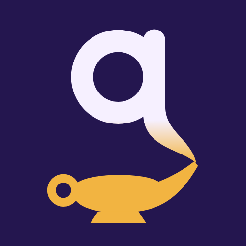

  

<h1 align="center">Geenie-AI</h1>

Agentic AI solutions for any platform and any programming language.

## What we build

Geenie-AI builds solutions that help developers create state-of-the-art agentic AI systems. Everything here is designed to work with the platform and programming language you already use, so you aren't tied to a single vendor or stack.

## Get involved

Issues and pull requests are welcome in any repository. If you have an idea for a new solution, or want support for another platform or language, open an issue in the repository it belongs to.

## Repositories

<!-- REPOS:START -->
_The repository list is generated by a workflow and appears here after its first run._
<!-- REPOS:END -->
